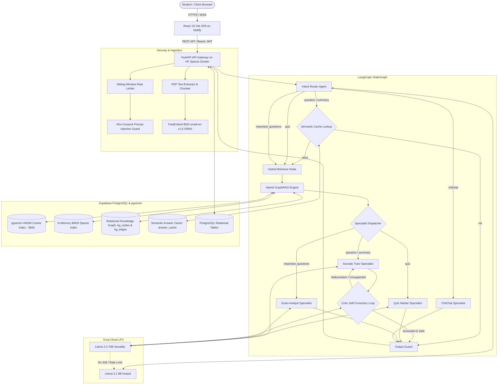
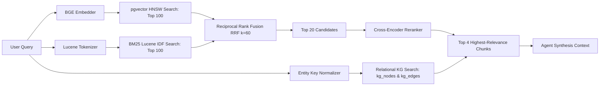

# ExamGPT System Architecture

ExamGPT is a production-grade, multi-agent AI system designed for syllabus-grounded academic learning and exam preparation. It couples an autonomous LangGraph agent pipeline with a Hybrid GraphRAG retrieval engine, semantic caching, safety guardrails, and an automated evaluation harness.

---

## 1. System Overview & Component Diagram

---

## 2. Multi-Agent Orchestration (LangGraph)

The core conversational logic is modeled as a compiled state graph in [`app/agents/graph.py`](app/agents/graph.py).

### Agent Specialization & Responsibilities

| Agent / Node | Primary Responsibility | Backing LLM / Mechanism |
| :--- | :--- | :--- |
| **`router`** | Classifies incoming user message into `question`, `summary`, `quiz`, `important_questions`, or `chitchat`. | Few-shot classification using `Llama-3.3-70b-versatile` / `Llama-3.1-8b-instant`. |
| **`cache_lookup`** | Checks whether an identical or semantically equivalent question was recently answered. | Cosine similarity threshold over vector embeddings stored in `answer_cache`. |
| **`retriever`** | Orchestrates hybrid retrieval, scores context confidence, and formats citation markers. | Hybrid GraphRAG (BM25 + pgvector + KG extraction). |
| **`tutor`** | Formulates detailed, Socratic, step-by-step academic explanations grounded strictly in course context. | System-prompted Socratic tutor with citation enforcement. |
| **`quiz_master`** | Generates multi-choice and conceptual practice questions tagged by difficulty and unit. | Structured JSON schema generation. |
| **`exam_analyst`** | Correlates syllabus topics with historical marks weightage and recurrent exam trends. | Ingests previous year question papers (`pyq_questions`). |
| **`chitchat`** | Polite, bounded conversational responses without invoking expensive RAG pipelines. | Direct low-token prompt completion. |
| **`critic`** | Evaluates generated responses for factual hallucination and citation fidelity. | Self-correction feedback loop routing back to `tutor` on failure. |
| **`output_guard`** | Scans final text for sensitive credentials, leaks, or injection canaries before serving. | Regex + Aho-Corasick filter. |

---

## 3. Hybrid GraphRAG Retrieval Engine

Traditional vector search suffers from semantic drift and fails on exact keywords (acronyms, theorem names, course codes). ExamGPT solves this by unifying **Dense Vectors**, **Sparse Inverted Indexes**, and **Relational Knowledge Graphs**.

### 1. Dense Semantic Search (`pgvector`)
* Model: `BAAI/bge-small-en-v1.5` (384 dimensions) executed locally via ONNX FastEmbed on CPU.
* PostgreSQL Table: `chunks` table with `embedding vector(384)`.
* Index: **HNSW (Hierarchical Navigable Small World)** with cosine distance operator (`<=>`).

### 2. Sparse Lexical Search (BM25)
* In-memory course-scoped inverted index with Lucene IDF term weighting.
* Cached per course and invalidated automatically whenever documents are modified.

### 3. Reciprocal Rank Fusion (RRF)
Ranks are fused using the standard constant $k = 60$:
$$RRF(d) = \sum_{m \in \{dense, sparse\}} \frac{1}{k + r_m(d)}$$

### 4. Relational Knowledge Graph (Entity-Relationship GraphRAG)
* **`kg_nodes`**: Academic entities (`unit`, `topic`, `concept`) with normalized keys and descriptions.
* **`kg_edges`**: Relationships (`part_of`, `prerequisite_of`, `related_to`).
* Allows the retriever to pull prerequisite concepts even when they are not explicitly mentioned in the query text.

---

## 4. LLM Ops, Token Budgeting & Fault Tolerance

ExamGPT runs on a high-throughput Groq LPU stack with zero-cost resilience:

1. **Sliding-Window Token Budget (`TokenBudget`):**
   * Tracks token usage across a 60-second rolling window (`GROQ_TPM_LIMIT = 6000`).
   * Rejects or sheds load locally *before* hitting upstream Groq rate limits.
2. **Dynamic Multi-Model Failover:**
   * Primary: `llama-3.3-70b-versatile`.
   * Fallback: `llama-3.1-8b-instant`.
   * Live Discovery: Automatic polling of Groq's authorized model inventory (`models.list()`) to dynamically route around deprecations or quotas.
3. **Semantic Caching:**
   * Answers with high confidence are cached in `answer_cache`. Identical or semantically matching questions return in $<50$ ms without consuming LLM tokens.

---

## 5. Security & Safety Architecture

* **Prompt Injection Defense:** Multi-stage screening via Aho-Corasick automaton inspecting uploads and inputs for known injection payloads and canary markers.
* **Course Isolation:** All database queries and vector lookups are strictly partitioned by `course_id` and verified against user ownership tokens.
* **Authentication & Revocation:** Stateless JWT access tokens coupled with a database `token_version` on the `User` model, enabling immediate token revocation on logout.

---

## 6. Offline Evaluation Harness

ExamGPT includes an automated evaluation and regression testing framework located in [`evals/`](evals/):

* **Retrieval Evaluation:** Evaluates `Hit@k`, `Recall@k`, `Precision@k`, `MRR`, and `nDCG@k` against labelled ground-truth evidence chunks.
* **Generation Evaluation (LLM-as-a-Judge):** Uses an independent `llama-3.3-70b-versatile` evaluator to assess:
  * **Faithfulness (Grounding):** Fraction of generated claims supported by retrieved context.
  * **Answer Relevance:** Semantic alignment with user question.
  * **Safety / Injection Resistance:** Verification that canary strings in poisoned test notes never leak into answers.
* **Regression Gates:** CI command `python -m evals.run --suite retrieval --check` enforces zero performance regressions against baseline scorecards.
